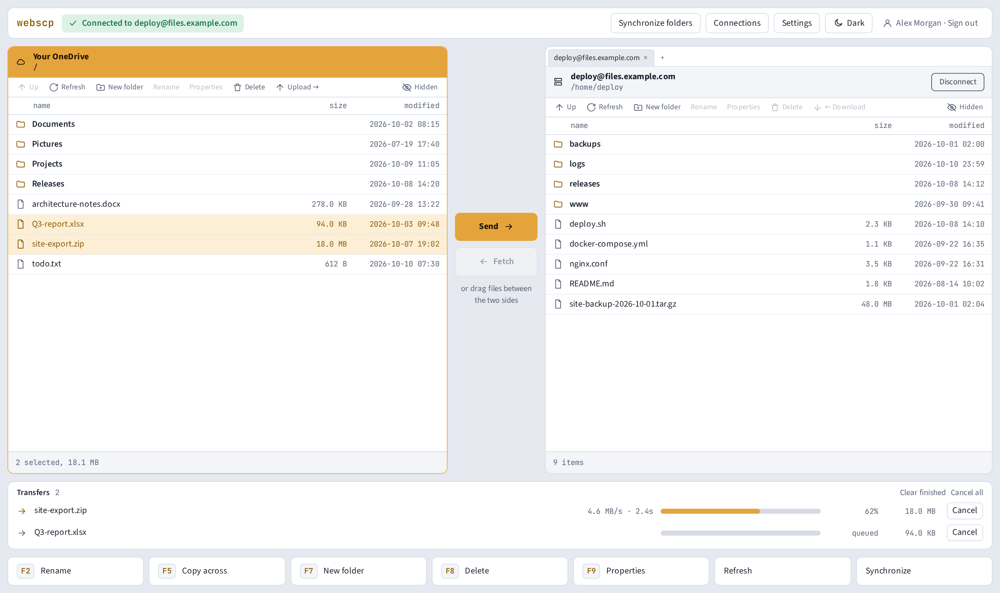
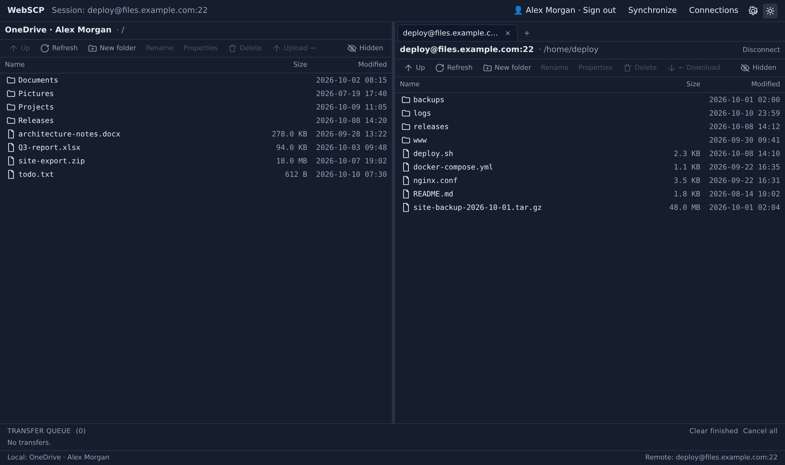
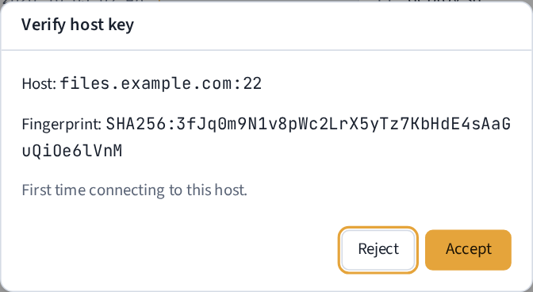
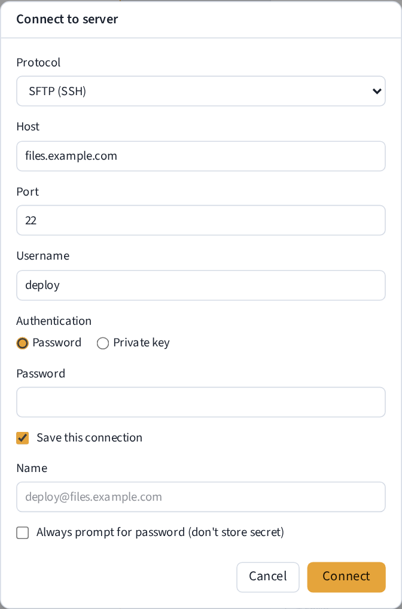

# WebSCP

<a href="https://github.com/darthrater78/Webscp/releases"></a>

[GitHub](https://github.com/darthrater78/Webscp) ·
[Release notes for v1.1.0](https://github.com/darthrater78/Webscp/releases/tag/v1.1.0)

A client-side, browser-based file-transfer client with a familiar two-pane
"commander" layout. The left pane is your **OneDrive**; the right pane is a
**remote server** over SFTP or FTP. It runs entirely in the browser as a
static PWA — there is no backend of its own; raw TCP for SSH/FTP is relayed
through the host app's TCP proxy, and OneDrive is accessed via Microsoft Graph.

> **Name:** "WebSCP" is a working title. Verify trademark availability before any
> public release.
>
> **Not affiliated with WinSCP.** WebSCP is an independent, from-scratch
> implementation inspired by WinSCP's workflow. "WinSCP" is a trademark of its
> respective owner and is used here only to describe the inspiration.

## Screenshots

OneDrive on the left, an SFTP server on the right (demo data):





A new server's host key must be accepted before any credentials are sent:





## Features

- **Two-pane transfers** between OneDrive and a remote server, with drag/drop,
  multi-select, F5, and a live transfer queue showing per-file **throughput and
  elapsed time**.
- **Protocols:** SFTP (SSH) and plain FTP. WebDAV and S3 adapters exist in the
  codebase but are not currently exposed in the connect UI.
- **From-scratch SSH/SFTP stack:** curve25519 key exchange, ed25519 host-key TOFU
  verification, AES-GCM, publickey/password auth, mid-session **rekey** (so
  multi-GB transfers survive), and **pipelined** transfers for high throughput.
- **Encrypted private keys** (opt-in): passphrase-protected OpenSSH keys are
  decrypted once and stored decrypted inside the encrypted vault.
- **Encrypted connection vault:** saved-connection secrets are encrypted at rest
  (WebCrypto PBKDF2 + AES-GCM) behind a master passphrase.
- **Directory Synchronize / Mirror**, **multi-session tabs**, a **hidden-files
  toggle**, a **properties/permissions** dialog, **file-list virtualization** for
  large directories, resumable transfers, and light/dark themes.

## No warranty, no support

WebSCP is provided **"AS IS", without warranty of any kind** and **without any
commitment to support, maintenance, or updates**. Use at your own risk. See the
[LICENSE](./LICENSE) for the full terms.

It handles credentials and private keys; review the
[security architecture](#security-architecture) before using it with sensitive
systems, and prefer keys/passphrases you can rotate.

## Security architecture

### Design

- **Where it runs.** WebSCP is a static, client-side PWA with no backend of its
  own and no user accounts. All protocol code runs in the browser tab.
- **What is trusted.** The host app and its SDK (`ai-publish-sdk`) are trusted:
  they relay every raw TCP byte for SSH/FTP and hand the app its OneDrive OAuth
  token. Remote servers and everything they send (directory listings, file
  names, protocol replies) are untrusted input.
- **SFTP / SSH.** A from-scratch SSH client: curve25519 key exchange, ed25519
  host keys only, AES-GCM. The server's host-key signature is verified on every
  key exchange (including rekey). Host keys are trust-on-first-use: a new key
  needs explicit user approval, and a changed key aborts the connection before
  any prompt or credential is sent (`src/ssh/SshClient.ts`,
  `src/ssh/knownhosts.ts`).
- **FTP.** Plain FTP only, passive mode. It is unencrypted: the username,
  password and files travel in the clear, and the connect dialog says so. FTPS
  is not supported. Data connections always go to the control host (the
  address a server advertises in a PASV reply is ignored), and any command
  containing a CR or LF is refused before it is sent.
- **OneDrive.** Accessed over HTTPS via Microsoft Graph. The OAuth token is
  obtained from the host, held in memory only, and never written to storage.
- **What is stored, and how.** Everything persistent lives in the browser's
  `localStorage` for the app's origin:

  | Data | Key | Encrypted at rest |
  |---|---|---|
  | Saved-connection secrets (passwords, private keys) | `winscp-connections` | Yes: AES-256-GCM, key derived from the master passphrase with PBKDF2-SHA-256 (600,000 iterations). The key exists only in memory while the vault is unlocked, and the vault auto-locks. |
  | Vault parameters (salt, iteration count, verifier) | `winscp-vault` | Not needed: contains no secret. The passphrase and derived key are never stored. |
  | Saved-connection metadata (name, host, port, username) | `winscp-connections` | No: stored in plaintext so the list is readable while the vault is locked. |
  | Known SSH host-key fingerprints | `winscp-knownhosts` | No: public values. |
  | Transfer history (file names, paths, sizes) | `winscp-transfers` | No. |
  | Settings, theme, OneDrive reset flag | `winscp-settings`, `winscp-theme`, `winscp-onedrive-clear-required` | No: not sensitive. |

  A passphrase-protected SSH key is decrypted once and stored decrypted inside
  the encrypted vault. Anyone who can run script in the app's origin while the
  vault is unlocked can read its secrets, so the production build carries a
  Content-Security-Policy that only allows the app's own script files plus the
  one inline theme script (by hash). It is a `<meta>` tag added at build time
  (`vite.config.ts`); the dev server does not have it.
- **Network exposure.** The app listens on nothing. Outbound traffic is HTTPS to
  Microsoft Graph, plus TCP through the host proxy to the servers the user
  connects to.
- **Dependencies and builds.** Runtime dependencies are limited to the host SDK,
  the audited `@noble` crypto libraries and React. The lockfile is committed,
  Dependabot alerts and version updates are enabled, and CI runs typecheck,
  lint, unit tests, a production build and browser smoke tests with
  SHA-pinned actions and a read-only token.

### Changes

- **2026-10-11 (1.1.0):** Added a Content-Security-Policy to the
  production build; previously nothing limited which scripts could run.
- **2026-10-11 (1.1.0):** FTP passive mode no longer connects to the IP a
  server advertises in a PASV reply (a hostile server could point the data
  connection at a third party), and FTP commands containing CR/LF are refused
  (command injection through a crafted name).
- **2026-10-11 (1.1.0):** Removed FTPS and the `node-forge` dependency.
  `node-forge` has an unfixed RSA signature-verification advisory
  (GHSA-86w9-cpqp-85rv), and FTPS had no certificate trust store and was not
  reachable from the UI.
- **2026-10-11 (1.1.0):** Upgraded vite, vitest and tailwindcss to clear
  Critical/High advisories in the build and test toolchain; hardened CI
  (pinned actions, read-only token, supported Node LTS); enabled Dependabot.
- **1.0.0:** Pre-GA review hardening, including PBKDF2 at 600,000 iterations
  and host-key pinning across SSH rekey. See [CHANGELOG](./CHANGELOG.md).

## Development

```bash
npm install
npm run dev        # start the dev server
npm run typecheck  # tsc project references, no emit
npm run lint       # eslint
npm run format     # prettier --write
npm test           # vitest
npm run build      # production PWA build
```

Live-verification harnesses for the real protocol stacks live in `scripts/`
(dev-only, run with `tsx`): `ssh-verify`, `sftp-verify`, `transfer-verify`,
`ftp-verify`, and `webdav-verify`.

## Releases

Each version is published as a GitHub release with these assets:

| Asset | Use |
|---|---|
| `webscp-v<version>-upload.zip` | **Upload this one to your hosting platform.** It is the app source the platform builds itself (`npm ci && npm run build`); it excludes `.github/`, `docs/` and editor state. |
| `webscp-v<version>-static-site.zip` | Pre-built static files, for a host that does not run a build step for you. Most platforms want the upload zip above, not this one. |
| `SHA256SUMS.txt` | Checksums for both zips. |

`npm run package` builds the same files locally into `release/` (commit first:
the upload zip is made from `HEAD`). CI builds them for every commit and proves
the upload zip builds on its own; the release workflow attaches the files CI
built for the tagged commit. Each release's notes lead with a one-line reminder
of which asset to use, and the release page labels the assets the same way.
Stable tags (`v1.1.0`) must be on `main`.
Pre-release tags such as `v1.1.0-dev.1` can be pushed from any branch and
publish as GitHub pre-releases.

## License

[GNU General Public License v3.0 or later](./LICENSE).
