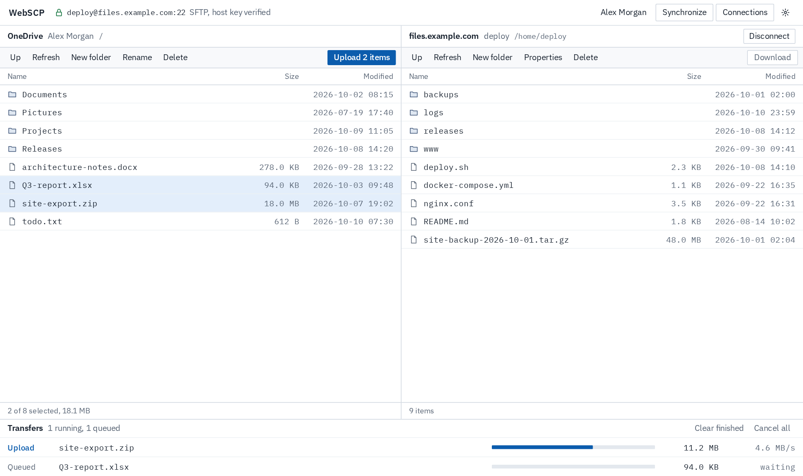
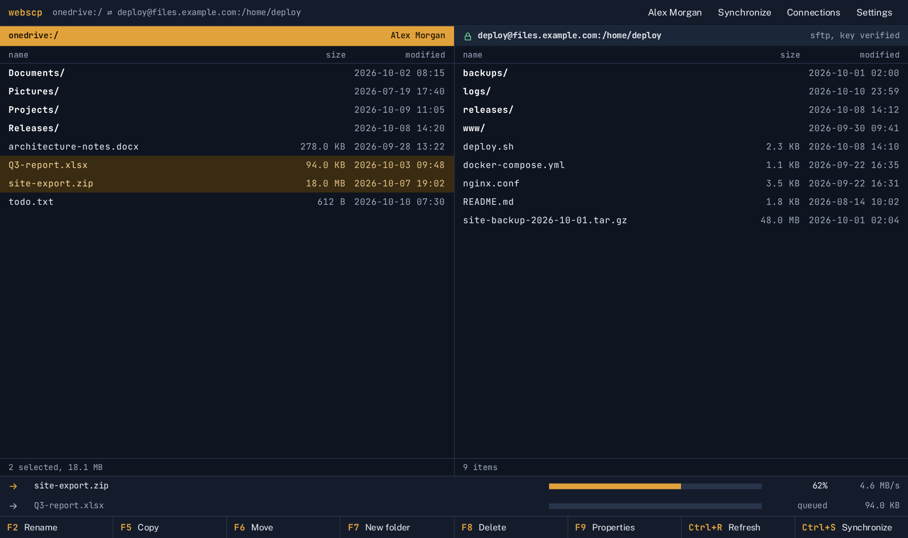
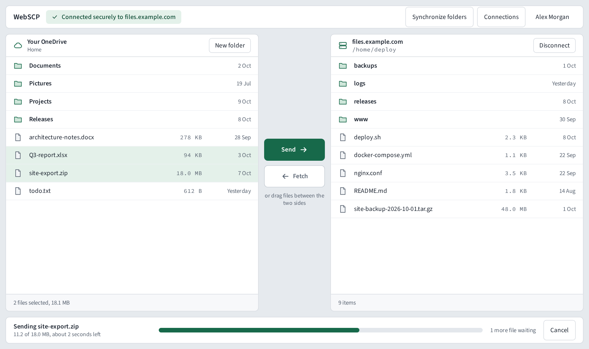
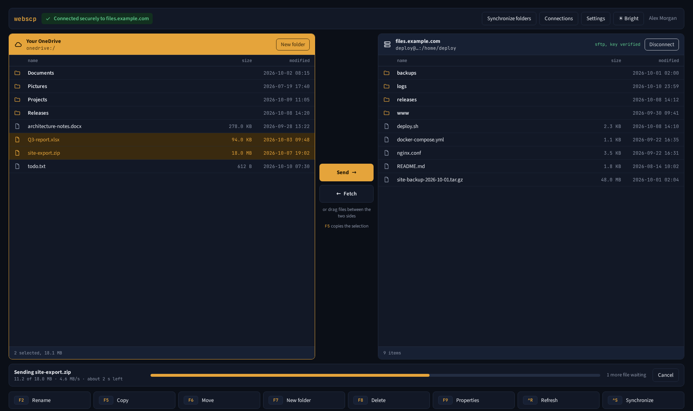
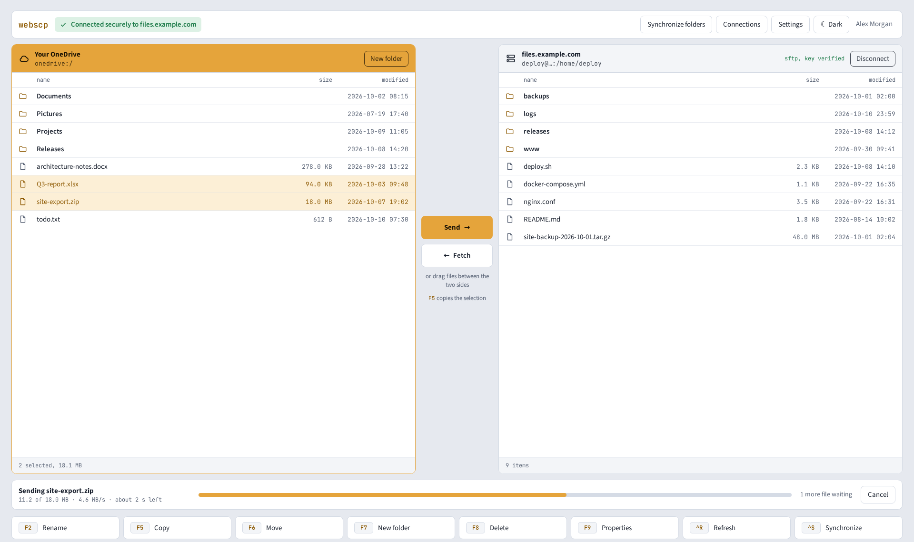

# Design directions

Mockups of the same screen (OneDrive on the left, an SFTP server on the
right, one transfer running), drawn on 2026-10-11 to choose a direction for
`DESIGN.md`. All names and files are demo data.

## A · Console

Light and dense: 28 px rows, hairline borders, 2 px corners, IBM Plex Sans with
IBM Plex Mono for file data, a deep blue accent. Closest to the current layout.

## B · Dusk

Dark-first and keyboard-driven: all-monospace file lists (JetBrains Mono),
square corners, an amber accent, and a function-key bar along the bottom.

## C · Workbench

Light and roomy: 38 px rows, rounded panels on a grey ground, Send/Fetch
buttons between the panes, plain-language status, Source Sans 3, a green accent.

## D · Dusk Workbench (picked)

B's dark ground, amber accent, monospace file data and function-key bar, set in
C's rounded panes with the Send/Fetch column and plain-language status, in dark
and bright themes. Picked on 2026-10-11, written down in
[`DESIGN.md`](../../DESIGN.md) and built into the app. The HTML source is
`mockups/D-dusk-workbench.html`.

## What the old UI had that none of these keep

- Emoji used as icons (cloud, monitor, person).
- Tailwind's stock blue (`#2563eb`) and red (`#dc2626`) as accent and danger.
- A system font stack that nobody chose.
